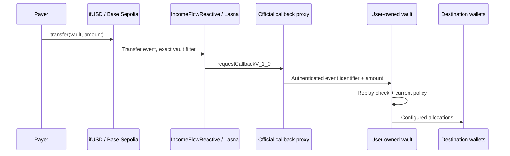

# IncomeFlow — Give every payment a purpose.

**From payment requested to income organized.** For independent professionals, finishing a project can leave another workload: requesting payment, tracking what arrives, organizing income and retaining the record. IncomeFlow connects those steps for supported crypto payments.

[Open IncomeFlow](https://incomeflow-gamma.vercel.app) · [Inspect on-chain proof](https://incomeflow-gamma.vercel.app/proof)

Built for freelancers and independent professionals in the Reactive Omni Buildathon’s **Set It and Forget It** track. This is a **testnet prototype**, using valueless **MockIncomeUSD (ifUSD)**. Tax reserve percentages are user choices, not tax advice or calculated liabilities.

## Why we built it

Imagine a freelance designer delivering a website. The work is finished, but a payment still needs requesting, transfers need identifying, outstanding amounts need tracking, and income needs organizing. This is an illustrative scenario, not a customer testimonial.

**From payment requested to income organized.** IncomeFlow connects a supported crypto payment request to explicitly associated transfers, automatic spending/savings/reserve allocations and a record the recipient can recover.

QuickBooks’ 2026 report says 59% of surveyed small businesses had invoices overdue at least 30 days. This is broader small-business research, not a statistic about crypto freelancers or evidence that IncomeFlow improves collection. [Primary report](https://quickbooks.intuit.com/r/small-business-data/small-business-late-payments-report-2026/); [research and methodology caveats](docs/PROBLEM_RESEARCH.md), including Chaser’s receivables-administration findings.

## What Payment Passport adds

Established payment splitting and invoicing tools already solve valuable parts of this problem. Our narrower workflow connects an owner-signed, shareable ifUSD request to exact token-transfer logs, partial-payment progress and verified allocation receipts. We do not infer a job match from amount or time. The owner explicitly signs each association; payer identity remains unverified. [Comparison and evidence limits](docs/COMPETITIVE_DIFFERENTIATION.md).

1. Create and review a request for an actual owned IncomeFlow vault; sign its structured data.
2. Share the independently verifiable request. The client checks the owner, chain, token and receiving address.
3. Send supported test ifUSD using an ordinary ERC-20 transfer. Reactive triggers allocation without an online freelancer or backend payout bot.
4. Associate the exact transaction hash and log index with the request. Verify partial/outstanding amounts and the separate allocation evidence.
5. Export the client receipt or full owner Passport; back up browser-local records for another device.

[Payment Passport specification and limitations](docs/PAYMENT_PASSPORT.md). The feature branch's current verification/release state is in [BUILD_STATUS](docs/BUILD_STATUS.md); the previously verified release remains the fallback until its extension passes.

## A signed request. Two real partial payments.

The illustrative website-design request was owner-signed before two genuine testnet transfers: **40 + 60 ifUSD**. The owner signed an explicit association to each exact token log. Their verified allocations were **20/12/8 + 30/18/12**, totaling **50/30/20 ifUSD**, with **zero outstanding** in the associated record. These are engineering payments using one disposable owner/payer account, not commercial client income.

[Inspect the Payment Passport](https://incomeflow-gamma.vercel.app/passport-demo?view=owner) · [Client receipt](https://incomeflow-gamma.vercel.app/passport-demo) · [Signed proof manifest](deployments/passport-proof.json)

| Payment | Origin | Reactive execution | Callback and actual payouts |
| --- | --- | --- | --- |
| 40 ifUSD, log 10 | [Transfer](https://sepolia.basescan.org/tx/0xdc6f6488ac482b330b5e26eaec5e4aebd8f2acd9b7137164fa99dc07104fe964) | [Execution](https://lasna.reactscan.net/tx/0x7dc8bb4d7775d2a7d22989de6b35338bf696a873ce22b411dd6deb002e3e4b10) | [20/12/8](https://sepolia.basescan.org/tx/0xdff7ee7715f54a4a119001cbee4965b6cde358317d1d14ec2ac497a4812590b9) |
| 60 ifUSD, log 29 | [Transfer](https://sepolia.basescan.org/tx/0xc038b2871e76c59fa9e1c12721f3734b24b1d9231340e86804f71be5aea9e8da) | [Execution](https://lasna.reactscan.net/tx/0x0807477dab0eac199dfa65eba7416097c593b718dc8cab89d985f80de590077a) | [30/18/12](https://sepolia.basescan.org/tx/0xb1f4ee25f1c47cb6d3f3f1330160b06f57392b7f0639fb5e220ab9bd5684dc91) |

Existing user vault: [0xd70db6249b22cb72a463cc26849e85fa699d37c1](https://sepolia.basescan.org/address/0xd70db6249b22cb72a463cc26849e85fa699d37c1). Its Reactive contract: [0x30fc195918738aBf90BA5B626Dfa98F99d5Ca200](https://lasna.reactscan.net/address/0x30fc195918738aBf90BA5B626Dfa98F99d5Ca200). No redeployment or funding exchange was needed for Passport.

## Verify the working automation

A genuine 100 ifUSD deposit produced **50 / 30 / 20 ifUSD** destination transfers. A second, real callback for the same event emitted `DuplicateIgnored` and transferred nothing. All three contracts have exact creation and runtime source matches on Sourcify. Full receipts, before/after balances and reproduction instructions: [on-chain proof](docs/ONCHAIN_PROOF.md).

| Component | Network | Address / evidence |
| --- | --- | --- |
| MockIncomeUSD | Base Sepolia · 84532 | [0x2d1045a2025d197Ee83723452B505bec38427CE9](https://sepolia.basescan.org/address/0x2d1045a2025d197Ee83723452B505bec38427CE9) |
| Demonstration vault | Base Sepolia · 84532 | [0x361890c8550548bB5c1A2C40e009470a259cf41E](https://sepolia.basescan.org/address/0x361890c8550548bB5c1A2C40e009470a259cf41E) |
| Reactive contract | Lasna · 5318007 | [0x07B1f3295A076e52403811B5128f4e479E4D0C3d](https://lasna.reactscan.net/address/0x07B1f3295A076e52403811B5128f4e479E4D0C3d) |
| Incoming payment | Base Sepolia | [Origin receipt](https://sepolia.basescan.org/tx/0x6ba488437a060f491d63346899298e7c5526703b7e03a393329e90ad0f5cf031) |
| Reactive execution | Lasna | [Execution receipt](https://lasna.reactscan.net/tx/0xfe0331a80d2d8e640964c486f0d3454616f6c5d004895c2a4d8ce22cdb1825bc) |
| Authenticated distribution | Base Sepolia | [Callback and payouts](https://sepolia.basescan.org/tx/0x65ce581bfe4ccb1524ce36a65129a6a00405d7500fa5fadb48942ef7cae8c030) |

The observed Base block timestamps differed by two seconds in this run. That is one observation, not a latency guarantee. See [deployment manifest](deployments/testnet.json) and [verification metadata](deployments/verification.json).

## Why Reactive is essential

An ERC-20 transfer emits its event from the **token**, and does not invoke a receiving vault. IncomeFlow subscribes narrowly to that token’s `Transfer` event and the exact indexed vault destination. Reactive Omni performs the event-to-callback work even while the recipient is offline. There is no backend payout wallet or cron job controlling custody.



Each user creates an independent vault and Reactive contract. Only the vault owner can edit rules or recover funds. The vault authenticates both the official callback provider and its specific Reactive sender. A payment uses the rules active **when its callback executes**; receipts report that policy version. Integer basis points total 10,000; the final recipient receives the rounding remainder.

## Application

- Injected EVM wallet connection, disconnect and supported-network switching.
- Resumable independent vault/Reactive setup and subscription registration.
- Allocation editor with exact totals, address validation and saved browser drafts.
- Receiving address, explicitly labeled test-token faucet and genuine test payment.
- Chain-backed balances, paginated activity and downloadable receipts.
- Fee balances, subscription/debt diagnostics, pause/resume, callback retry and paused recovery.
- Public proof/help views; light/dark themes and reduced-motion support.

Disconnected visitors can inspect the verified demonstration vault or start with an empty workspace. The sample calculator on the landing page is labeled illustrative. Live balances and receipts come from RPC reads, never fixture transactions.

## Run locally

Requires Node.js 22.23+ or 24 and npm. No database or paid service is required.

```sh
npm ci
cp .env.example .env
npm run dev
```

Open http://localhost:3000. Public RPC defaults work without API keys. See [.env.example](.env.example) for optional RPC overrides and deployment-only keystore paths. Never prefix signing secrets with `NEXT_PUBLIC_`.

For reliable browser QA, use the production server:

```sh
npm run build
npm run start -- --port 3098
# In a second terminal:
PLAYWRIGHT_BASE_URL=http://localhost:3098 npm run test:browser
```

## Contracts, tests and deployment

```sh
npm run contracts:bootstrap
npm run contracts:build
npm run contracts:test
npm run lint
npm run typecheck
npm test
npm run build
```

Foundry and Solidity 0.8.29 are required; the wrapper reuses local tools when available. Bootstrap pins the official current `reactive-lib-omni`, forge-std and OpenZeppelin. Contracts use Omni’s `onlySystem`, `LogRecord` and `requestCallbackV_1_0`; they do not use obsolete ReactVM assumptions.

Deployment is deliberately separate from CI. [Deployment guide](docs/DEPLOYMENT.md) explains encrypted disposable testnet accounts, funding, safe initialization order, exact subscriptions, source verification and resumable proof scripts. `npm run health` checks actual chains, funding and debt. Do not rerun funding or deployment blindly against the existing manifest.

See [testing](docs/TESTING.md), [security review](docs/SECURITY.md), [troubleshooting](docs/TROUBLESHOOTING.md), [architecture](docs/ARCHITECTURE.md), [research](docs/RESEARCH.md), [design system](docs/DESIGN_SYSTEM.md), and [current build status](docs/BUILD_STATUS.md).

## Engineering portfolio

**Cloud and deployment:** Deployed the Next.js frontend and read-only API to Vercel, separated public/server RPC configuration, and verified actual public HTTP responses, chain receipts and production viewport captures through GitHub Actions. No Neon database is needed.

**DevOps:** Preserved Git history, checkpoint commits, pinned dependencies, GitHub Actions for contract and web checks, reproducible deployment scripts and deployment manifests. CI never receives signing keys or automatically deploys financial contracts.

**Networking and APIs:** HTTPS JSON-RPC integration across two testnets; chain-ID validation; wallet authorization; event topic decoding; bounded event pagination; concurrent-request coalescing; explicit external-service errors and chain-backed receipt correlation.

**Reliability:** Fee/debt and subscription inspection, authenticated callback diagnostics, replay protection, owner-controlled pause/recovery and documented incident investigation. These are implemented diagnostics, not a claim of continuous production monitoring.

## Limitations and license

Supports only the deployed conventional demo ERC-20. Fee-on-transfer, rebasing and arbitrary tokens are excluded. Callback delivery can be delayed or fail; paused or recovered funds require the documented owner workflow. Public RPC history is bounded and paginated. The official callback query returned incomplete records in the verified run; raw receipts supply the evidence chain.

This is internally reviewed and tested, **not independently audited or ready for mainnet funds**. Original project code is [MIT](LICENSE). Fonts include their OFL notice. Pinned upstream Omni files have `UNLICENSED` SPDX identifiers; they are downloaded locally rather than vendored, and upstream licensing clarification is needed before redistribution or commercial use. No adoption, audited safety or production uptime is claimed.

## Demonstration film

The verified film is **150.0 seconds, 1920×1080 at 30 fps, H.264 with AAC narration**. It contains genuine moving signed-user setup/payment footage, actual 50/30/20 receipts and the separately labeled original M1 proof. Source, audio, captions and editorial cuts are in [video/](video/); the complete rendered file is kept outside Git history at `artifacts/video/incomeflow-demo.mp4`. [Verification report](deployments/video.json) · [timeline and reproduction](docs/VIDEO_TIMELINE.md). [Download the verified MP4](https://github.com/sopskistar/IncomeFlow/releases/download/incomeflow-testnet-demo/incomeflow-demo.mp4) · [release and captions](https://github.com/sopskistar/IncomeFlow/releases/tag/incomeflow-testnet-demo). The anonymous download was checked against the local SHA-256.
