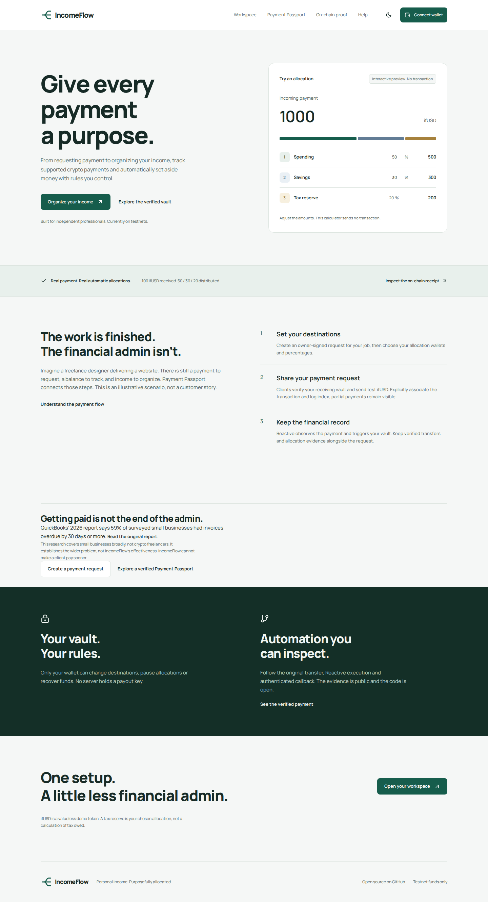
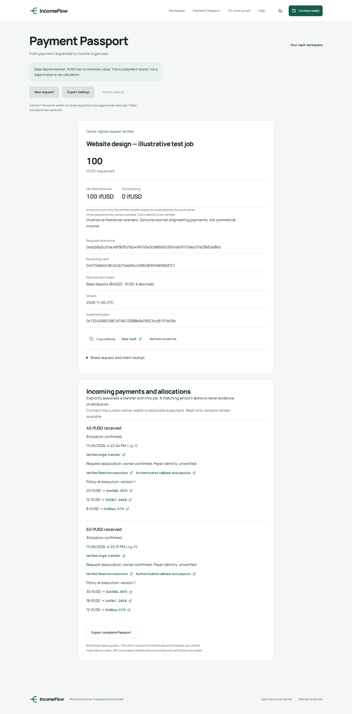
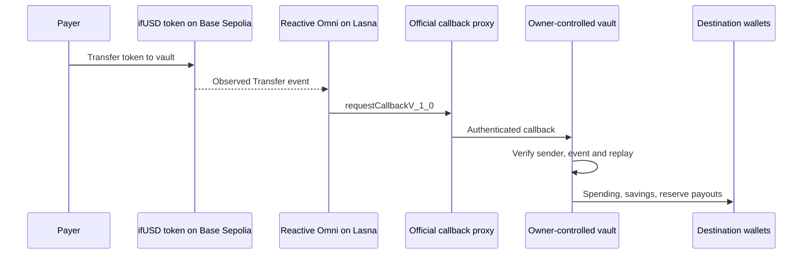

# IncomeFlow

**Give every payment a purpose.**

Built with **[Reactive Network Omni](https://reactive.network/)** — **Reactive Smart Contracts on Lasna**, listening to payment events on **Base Sepolia** and triggering authenticated cross-chain callbacks for automatic income allocation.

**From payment requested to income organized:** a no-code crypto-income workspace for freelancers, with owner-signed payment requests, partial-payment records, automatic on-chain allocations, and receipts that can be independently verified.

**[Watch the 2:30 demo](https://github.com/sopskistar/IncomeFlow/releases/download/incomeflow-payment-passport/incomeflow-passport-demo.mp4) · [Open the live app](https://incomeflow-gamma.vercel.app) · [Explore the real Payment Passport](https://incomeflow-gamma.vercel.app/passport-demo?view=owner) · [Verify the Reactive loop](https://incomeflow-gamma.vercel.app/proof)**

Built for the **[Reactive Omni Buildathon](https://dorahacks.io/hackathon/reactive-omni-buildathon/detail)**, **Set It and Forget It** track, using **Reactive Network Omni**, **Reactive Lasna**, and **Base Sepolia**.

> **Testnet prototype:** IncomeFlow currently uses MockIncomeUSD (**ifUSD**) on Base Sepolia. It does not collect unpaid invoices or calculate tax liability.

## The problem

**The work is finished. The financial admin isn't.**

Imagine a freelance designer who has delivered a website. They still need to request payment, identify which transfers arrived, track what remains outstanding, set aside savings and reserves, and maintain a reliable record. The same repetitive tasks return with every client.

This is a broader business problem, not a claim about IncomeFlow customers. [QuickBooks' 2026 Small Business Late Payments Report](https://quickbooks.intuit.com/r/small-business-data/small-business-late-payments-report-2026/) reported that **59% of surveyed small businesses** had invoices overdue by at least 30 days. Those figures are **not specific to crypto freelancers** and do not establish that IncomeFlow reduces payment delays. [Research, methodology and Chaser findings](docs/PROBLEM_RESEARCH.md).

## Our solution

**IncomeFlow connects the payment request, the verified incoming transfer, the automatic allocation, and the receipt.**

| Financial task | What IncomeFlow does |
| --- | --- |
| Request a payment | Creates an **owner-signed Payment Passport request** with supported token, chain, amount and verified vault address |
| Track what has arrived | Links **explicitly owner-associated** transaction hashes and exact token-log indices to a request |
| Account for partial payments | Shows verified received amounts, outstanding balance and overpayments using exact integer accounting |
| Organize income automatically | **Reactive Omni** observes supported ERC-20 transfers and triggers an authenticated callback that splits funds according to wallet-owner rules |
| Keep the evidence | Provides an owner Passport, a simpler client-facing receipt, explorer links and export/import of browser-local records |

**Why this is different from another token splitter:** the product is organized around a freelancer's *request → payment → allocation → record* workflow. Signing a request or associating a payment does **not** independently establish the payer's real-world identity or make an ERC-20 transfer contain an invoice ID. [Full trust and attribution limits](docs/PAYMENT_PASSPORT.md) · [Competitor comparison](docs/COMPETITIVE_DIFFERENTIATION.md).

## One payment request, two real transfers

A signed request for **100 ifUSD** preceded **two genuine Base Sepolia test payments** using the same disposable owner/payer account. This is an engineering demonstration, **not commercial client income**.

1. **Request:** A freelancer-style website-design example is signed by the current owner of an IncomeFlow vault.
2. **First payment:** **40 ifUSD** arrives. Reactive Omni triggers the authenticated callback, distributing **20 spending / 12 savings / 8 reserve**. **60 ifUSD remains outstanding.**
3. **Second payment:** **60 ifUSD** arrives. Reactive distributes **30 / 18 / 12**.
4. **Verified result:** **100 ifUSD received, 0 outstanding**, and **50 / 30 / 20** automatically allocated. The owner explicitly signs both exact payment-log associations.

**[Inspect the full, real Payment Passport](https://incomeflow-gamma.vercel.app/passport-demo?view=owner) · [Open the client receipt](https://incomeflow-gamma.vercel.app/passport-demo) · [View signed evidence](deployments/passport-proof.json)**

| Payment | Base Sepolia origin | Reactive Lasna execution | Authenticated callback & payouts |
| --- | --- | --- | --- |
| **40 ifUSD** · log 10 | [Transfer](https://sepolia.basescan.org/tx/0xdc6f6488ac482b330b5e26eaec5e4aebd8f2acd9b7137164fa99dc07104fe964) | [Execution](https://lasna.reactscan.net/tx/0x7dc8bb4d7775d2a7d22989de6b35338bf696a873ce22b411dd6deb002e3e4b10) | [20 / 12 / 8](https://sepolia.basescan.org/tx/0xdff7ee7715f54a4a119001cbee4965b6cde358317d1d14ec2ac497a4812590b9) |
| **60 ifUSD** · log 29 | [Transfer](https://sepolia.basescan.org/tx/0xc038b2871e76c59fa9e1c12721f3734b24b1d9231340e86804f71be5aea9e8da) | [Execution](https://lasna.reactscan.net/tx/0x0807477dab0eac199dfa65eba7416097c593b718dc8cab89d985f80de590077a) | [30 / 18 / 12](https://sepolia.basescan.org/tx/0xb1f4ee25f1c47cb6d3f3f1330160b06f57392b7f0639fb5e220ab9bd5684dc91) |

User-controlled demonstration [vault](https://sepolia.basescan.org/address/0xd70db6249b22cb72a463cc26849e85fa699d37c1) and its associated [Reactive contract](https://lasna.reactscan.net/address/0x30fc195918738aBf90BA5B626Dfa98F99d5Ca200). The original independent 100 → 50/30/20 M1 and signed-wallet acceptance tests remain documented separately in [ONCHAIN_PROOF](docs/ONCHAIN_PROOF.md).

## Try it and verify it

| Try | What to inspect |
| --- | --- |
| [Live IncomeFlow](https://incomeflow-gamma.vercel.app) | Product overview and clearly labeled **interactive preview**; changing preview values does **not** send tokens |
| [Public Payment Passport](https://incomeflow-gamma.vercel.app/passport-demo?view=owner) | Signed request, verified 40/60 transfers, receipt links, actual 50/30/20 allocations and zero outstanding — **no wallet needed to inspect** |
| [Client-facing receipt](https://incomeflow-gamma.vercel.app/passport-demo) | Limited receipt view that does not expose the owner's private local labels |
| [Original M1 proof](https://incomeflow-gamma.vercel.app/proof) | Separate genuine 100-token event → Reactive → callback, replay no-op and verified contracts |
| [Connect your wallet](https://incomeflow-gamma.vercel.app/app) | Create an independent vault, configure allocations and test your own automation; requires **testnet** balances and transaction signatures |

The app never substitutes simulated fixture transactions for live on-chain proof. A wallet is not required just to inspect the recorded verified demonstration.

## Demo video and visuals

**[Watch or download the final Payment Passport video](https://github.com/sopskistar/IncomeFlow/releases/download/incomeflow-payment-passport/incomeflow-passport-demo.mp4) · [Video release, captions and verification](https://github.com/sopskistar/IncomeFlow/releases/tag/incomeflow-payment-passport)**

The **150-second, 1920×1080, 30 fps H.264/AAC** film includes the research-qualified freelancer scenario, genuine moving product footage, both real partial test payments, the Reactivity evidence and final confirmed allocations. [Video verification report](deployments/video-passport.json). The previous [original M1 video](https://github.com/sopskistar/IncomeFlow/releases/tag/incomeflow-testnet-demo) is preserved separately.

**Actual production screenshots:** [Homepage desktop](docs/screenshots/incomeflow-homepage-desktop.png) · [Payment Passport desktop](docs/screenshots/payment-passport-desktop.png) · [Homepage mobile](docs/screenshots/incomeflow-homepage-mobile.png).  [View/download the GitHub Actions desktop, tablet, mobile, Passport and vault capture archive](https://github.com/sopskistar/IncomeFlow/actions/runs/45948544775/artifacts/15176435063). The embedded images above are real production captures, not generated mockups. The archive is a time-limited CI artifact.

## Why Reactive Omni

A plain ERC-20 transfer emits a `Transfer` log **from the token contract**; it does not call the receiving vault and execute arbitrary app logic.

**Reactive Network Omni** provides the missing unattended action: a Reactive contract on **Lasna** subscribes to the exact source-token/vault event, evaluates it, and requests a callback through the **official destination callback proxy**. The owner-controlled vault then validates the caller and Reactive sender, prevents replay, and pays the configured destinations atomically. There is **no backend payout bot, shared custodial wallet, or off-chain cron service** executing each allocation.

| Organizer infrastructure | IncomeFlow's use |
| --- | --- |
| **Reactive Network Omni / Lasna** (chain 5318007) | Reactive contract, event subscriptions and system-only log processing |
| **Base Sepolia** (chain 84532) | MockIncomeUSD transfers, user-owned vaults and real payout transactions |
| **Official Reactive callback service** | Authenticated request-to-callback path to the destination vault |
| **Reactive event/callback model** | Unattended action from a normal token transfer; measurable and independently verifiable receipts |

The request metadata and signed invoice association are **application-level features**; the actual token movement is done by Reactive + the vault. The current allocation policy at **callback execution time** applies, and its version is recorded. [Architecture and trust boundaries](docs/ARCHITECTURE.md) · [Payment Passport design](docs/PAYMENT_PASSPORT.md).

## On-chain contracts and source verification

| Contract | Network | Verified address |
| --- | --- | --- |
| MockIncomeUSD (ifUSD, 6 decimals) | Base Sepolia · 84532 | [0x2d1045a2025d197Ee83723452B505bec38427CE9](https://sepolia.basescan.org/address/0x2d1045a2025d197Ee83723452B505bec38427CE9) |
| Original M1 IncomeVault | Base Sepolia · 84532 | [0x361890c8550548bB5c1A2C40e009470a259cf41E](https://sepolia.basescan.org/address/0x361890c8550548bB5c1A2C40e009470a259cf41E) |
| Original M1 IncomeFlowReactive | Lasna · 5318007 | [0x07B1f3295A076e52403811B5128f4e479E4D0C3d](https://lasna.reactscan.net/address/0x07B1f3295A076e52403811B5128f4e479E4D0C3d) |
| Payment Passport demonstration vault | Base Sepolia · 84532 | [0xd70db6249b22cb72a463cc26849e85fa699d37c1](https://sepolia.basescan.org/address/0xd70db6249b22cb72a463cc26849e85fa699d37c1) |
| Payment Passport Reactive contract | Lasna · 5318007 | [0x30fc195918738aBf90BA5B626Dfa98F99d5Ca200](https://lasna.reactscan.net/address/0x30fc195918738aBf90BA5B626Dfa98F99d5Ca200) |

Original contracts have exact Sourcify creation/runtime source matches. The original M1 [origin](https://sepolia.basescan.org/tx/0x6ba488437a060f491d63346899298e7c5526703b7e03a393329e90ad0f5cf031) → [Reactive execution](https://lasna.reactscan.net/tx/0xfe0331a80d2d8e640964c486f0d3454616f6c5d004895c2a4d8ce22cdb1825bc) → [callback + payouts](https://sepolia.basescan.org/tx/0x65ce581bfe4ccb1524ce36a65129a6a00405d7500fa5fadb48942ef7cae8c030) is a separate 100 ifUSD demonstration. A live replay was rejected without another payout. The observed two-second Base timestamp interval is a **single observation, not a network guarantee**.

Full receipts, before/after balances and source matches: [ONCHAIN_PROOF](docs/ONCHAIN_PROOF.md) · [Deployment manifest](deployments/testnet.json) · [Passport signed evidence](deployments/passport-proof.json).

## Run locally

Requires **Node.js 22.23+ or 24**, npm, and Foundry for the contract workflows. No database or paid API is required.

~~~bash
git clone https://github.com/sopskistar/IncomeFlow.git
cd IncomeFlow
npm ci
cp .env.example .env
npm run dev
~~~

Open http://localhost:3000. The default public testnet RPCs work without API keys. Optional RPC overrides are documented in [.env.example](.env.example). **Never place signing secrets in NEXT_PUBLIC_ variables or commit wallet keys.**

### Build, test and verify

~~~bash
npm run contracts:bootstrap
npm run contracts:build
npm run contracts:test
npm run lint
npm run typecheck
npm test
npm run build
~~~

For browser testing, run the production server and Playwright in separate terminals:

~~~bash
npm run start -- --port 3098
# In a second terminal:
PLAYWRIGHT_BASE_URL=http://localhost:3098 npm run test:browser
~~~

The published release reports **28 Foundry tests, 25 unit tests, 20 local browser tests and 20 public browser tests passing**, plus internal security and visual reviews. [Build status and CI evidence](docs/BUILD_STATUS.md) · [Testing](docs/TESTING.md) · [Pre-submission audit](docs/PRE_SUBMISSION_AUDIT.md).

Deployment and testnet funding are separate from CI. Use [DEPLOYMENT](docs/DEPLOYMENT.md) and [TROUBLESHOOTING](docs/TROUBLESHOOTING.md); do not blindly redeploy, refill faucets or resend the existing proof transfers.

## Security, limitations and attribution

- **Owner-controlled funds and rules.** Each user controls an independent vault. Callback authentication checks the official proxy **and** its specific Reactive sender; replay protection and owner pause/recovery are tested.
- **Honest payment attribution.** Owner-signed requests and exact signed transfer-log associations do not prove a real client identity. A matching amount or timestamp alone is never treated as proof.
- **Testnet scope.** Only the supported conventional valueless ifUSD token is used; fee-on-transfer, rebasing and arbitrary tokens are excluded. Users need testnet ETH/lREACT funding for their own automation.
- **Reliability boundaries.** RPC history is bounded, callbacks can be delayed or fail, and browser-local Passport data requires export/import for recovery across devices.
- **Not an independent audit.** No critical/high issue was identified in the scoped internal review, but the project is **not independently security-audited or mainnet-ready**. Solar's parser incompatibility is documented, not presented as a passed scan. [Security review](docs/SECURITY_AUDIT.md).
- **Licenses and attribution.** Original project code is [MIT](LICENSE); bundled font license is OFL. The official upstream Omni files include licensing constraints that must be resolved before commercial redistribution. [Research](docs/RESEARCH.md).

## Cloud Engineering & DevOps

| Area | Implementation in this repository |
| --- | --- |
| **Cloud platforms and deployment** | Next.js on Vercel, public/API environment separation, deployment manifests and repeatable build verification; no Neon database required |
| **CI/CD** | GitHub Actions for web, contracts and public-browser journeys; pinned dependencies, versioned source, no signer secrets in CI |
| **Networking and API engineering** | Base Sepolia and Lasna JSON-RPC, chain-ID checks, EVM wallet authorization, token-event decoding, paginated history and explicit RPC errors |
| **Monitoring and reliability** | Funding and debt health, subscription diagnostics, callback traceability, duplicate protection, pause/recovery and incident documentation |
| **Architecture** | [System and trust-boundary diagrams](docs/ARCHITECTURE.md), [deployment guide](docs/DEPLOYMENT.md), [on-chain evidence](docs/ONCHAIN_PROOF.md) |

The diagnostic and deployment work is real; **continuous uptime monitoring, Terraform, AWS infrastructure and independent auditing are not claimed**.

## Hackathon submission and documentation

**Event:** [Reactive Omni Buildathon](https://dorahacks.io/hackathon/reactive-omni-buildathon/detail) · **Track:** Set It and Forget It · **Period:** November 5–December 5, 2026.

**Judging alignment:** real execution; essential Reactive integration; useful no-code automation; readable source, complete documentation and genuine footage.

[Submission draft & final checklist](docs/SUBMISSION.md) · [Judge proof](docs/ONCHAIN_PROOF.md) · [Current readiness](docs/BUILD_STATUS.md) · [Video and captions](https://github.com/sopskistar/IncomeFlow/releases/tag/incomeflow-payment-passport)

The deployed application, contracts and film have documented technical verification. **The authenticated DoraHacks portal deadline/fields and manual submission remain outstanding.** No submission has been made automatically.
