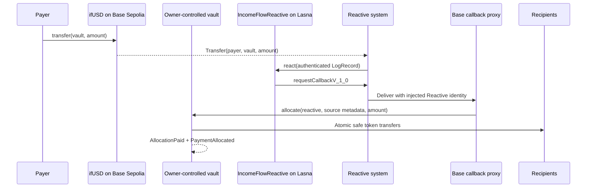

# Architecture

## Trust and custody

An ERC-20 transfer emits on the token, not the vault. Each RC filters chain 84532, the immutable token, canonical Transfer signature and exact vault topic2. Only SYSTEM may supply records. Validate three topics, clean address encoding, 32-byte amount, transaction hash and nonzero amount. Unrelated records return without reverting.

Each vault authenticates both its official callback proxy and immutable RC. The RC binds once, owner-only, after the vault exists. Owners cannot fabricate retries: payloads must originate in previously authenticated records. The callback carries no payout destinations; current owner-controlled on-chain rules determine them. No backend signer, shared custody or deployer override exists. Network event authenticity remains a Reactive trust boundary; the destination cannot independently prove remote logs.

## Accounting

Event ID: `keccak256(abi.encode(84532, token, vault, txHash, logIndex))`. Integer six-decimal ifUSD amounts, 2–8 distinct destinations, positive basis points totaling 10,000. Floor each share with full-precision `Math.mulDiv`; last recipient gets the remainder. A successful callback marks the ID then pays atomically using SafeERC20 under a reentrancy guard. A failure reverts marking, totals and all token transfers. Concurrent deposits may process out of order; they are identified independently and only their authenticated gross amount is consumed. Outgoing payouts cannot match the vault destination filter.

Rules use the version current at execution, including deposits made before an update. `PaymentAllocated` records that version; historical `PolicyUpdated` events reconstruct recipients/labels. The app must not infer old allocations from current rules.

## Failure and recovery

Callback gas is 1,000,000. Failed callbacks can be requested again by the RC owner after a 60-second timestamp cooldown; delivery is still idempotent. Subscription pause stops future observation and is distinct from vault pause, which stops allocations. Neither funding nor resume guarantees historical logs are replayed.

The vault owner may pause and recover the **entire supported-token balance** to the owner. Recovery records the current Base block as a cutoff and rejects callbacks at or below it so old withdrawals cannot consume new deposits. Same-block deposits are also excluded and remain recoverable. Unsupported tokens have a separate owner-only recovery. Two-step ownership changes reduce accidental loss; renunciation is disabled. No native-fee withdrawal is exposed in this MVP; top up conservatively.

## Web and storage

Next.js/TypeScript, Wagmi injected-wallet connection, Viem RPC reads/writes. Public deployment metadata contains only addresses, block cursors and verified references. Chain state and receipts are authoritative. No database controls custody or is required. History uses bounded paginated logs; RPC failures and truncated history must be shown. Unknown Reactive stages stay unknown until their events and delivery records are read.

## Application deployment and read model

Vercel serves the Next.js app and read-only `/api/vault/[address]` route. The API validates expected chains, supported token and callback provider, reads on-chain rules/accounting/fees, then correlates token Transfer, PaymentObserved, PaymentAllocated and AllocationPaid events. It uses 400-block Base pages split into 200-block RPC requests, 20-second per-instance caching and in-flight request coalescing. Old pages are explicit URL cursors. Archived M1 transaction references are re-read from actual receipts, not used as synthetic live data. Lasna query failure leaves stages/health unavailable rather than inferring success.

Wallet writes occur only through the connected EVM provider. Multi-step setup explicitly confirms the network for every step so React render state cannot skip a required switch. Confirmed public creation addresses are stored locally for resumption; the test runner separately persists every broadcast hash. Rule drafts use per-vault/per-policy session storage and survive navigation/reload. Saving removes the old draft while retaining the submitted values until the refreshed policy remounts the editor. The illustrative SSR calculator cannot accept edits until its handlers hydrate.

Neither local storage nor the public read API can authorize a callback or change a vault's recipients. No signing material is included in the app deployment. The optional encrypted Node signer exists only in opt-in test infrastructure.
